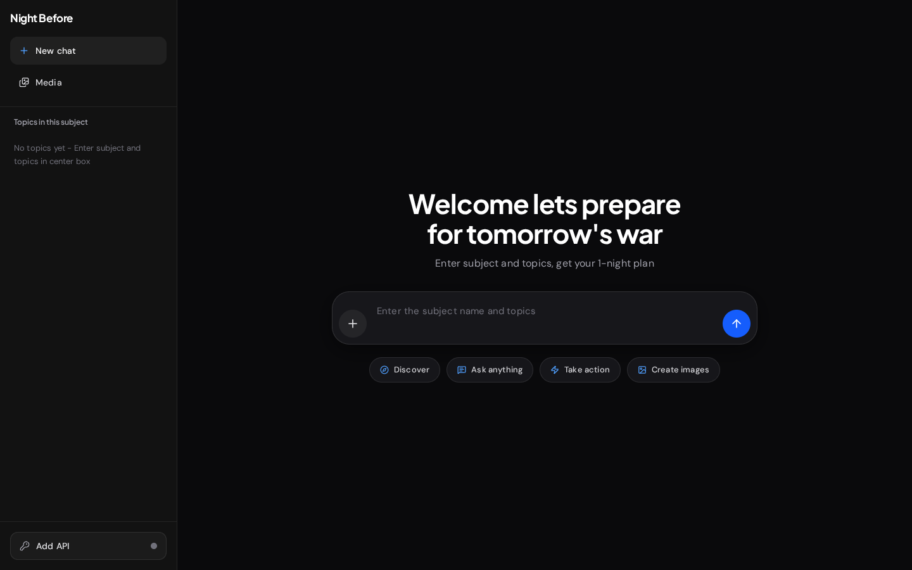
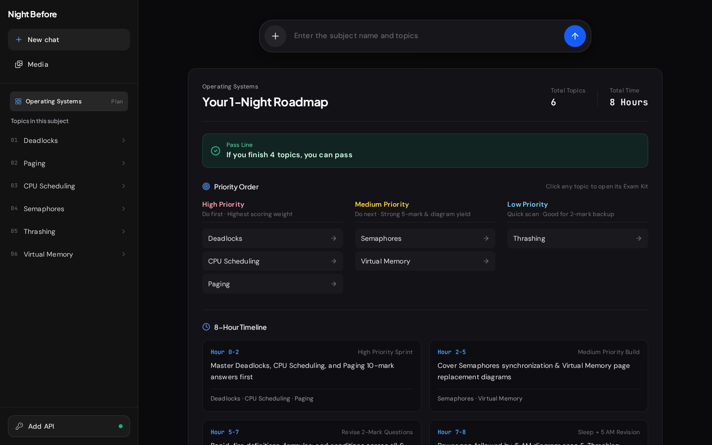
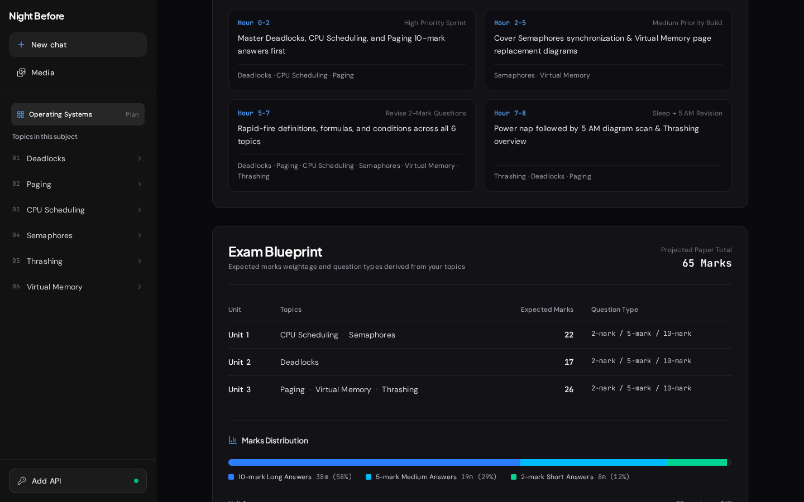
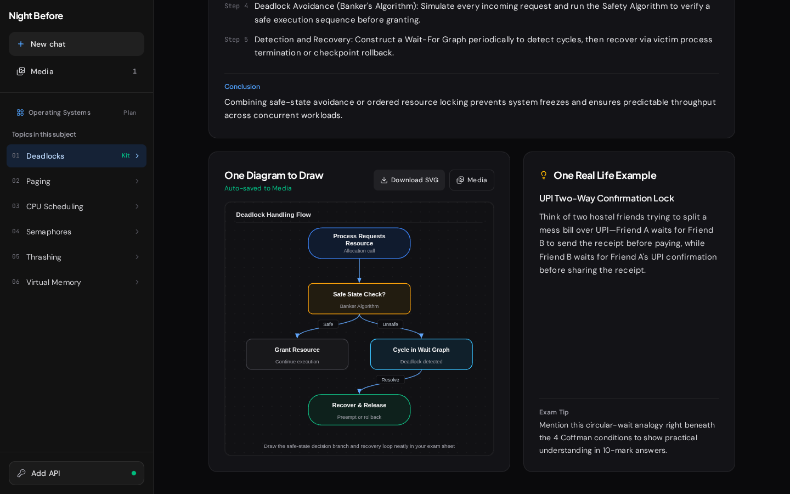
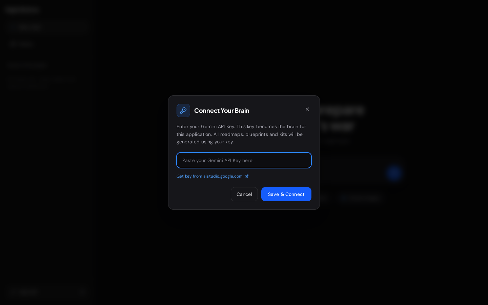
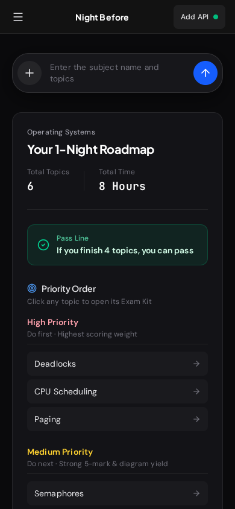
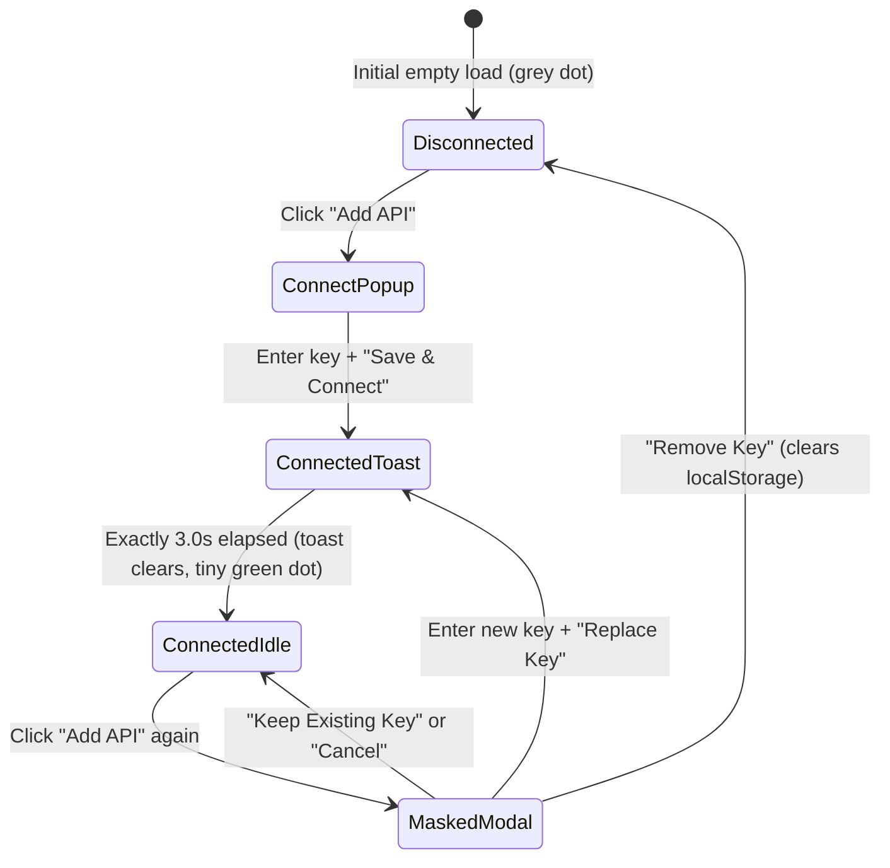
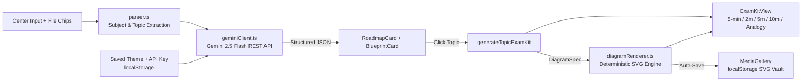

<div align="center">

# Night Before

### *Lets prepare for tomorrow's war*

A dark-theme, mobile-first chat-style study planner built for Indian BTech students.  
Enter **any subject and its topic list**—or attach syllabus PDFs, images, or notes—and get a structured **1-Night Roadmap**, **Exam Blueprint**, and **per-topic Exam Kits** with auto-saved vector diagrams, independent of university regulations or previous papers.

<p>
  <a href="#visual-tour"><strong>Visual Tour</strong></a>
  &nbsp;&middot;&nbsp;
  <a href="#quick-start"><strong>Quick Start</strong></a>
  &nbsp;&middot;&nbsp;
  <a href="#interactive-walkthrough"><strong>Interactive Walkthrough</strong></a>
  &nbsp;&middot;&nbsp;
  <a href="#api-key-security"><strong>API Key Security</strong></a>
  &nbsp;&middot;&nbsp;
  <a href="#architecture"><strong>Architecture</strong></a>
  &nbsp;&middot;&nbsp;
  <a href="#project-structure"><strong>Project Structure</strong></a>
</p>

<br />



</div>

---

## Why Night Before?

Most exam prep tools rely on university-specific question banks that go stale across regulations. **Night Before** starts completely empty and builds a complete 8-hour war plan strictly from the **topics you enter right now**:

| Capability | What You Get |
| :--- | :--- |
| **1-Night Roadmap** | Total topic count, 8-hour schedule (`Hour 0–2` High, `Hour 2–5` Medium, `Hour 5–7` 2-Mark Revision, `Hour 7–8` Sleep + 5 AM scan), priority tiers, and a clear **Pass Line**. |
| **Exam Blueprint** | Unit-by-unit table (`Unit` \| `Topics` \| `Expected Marks` \| `Question Type`) plus stacked and horizontal marks distribution bars across `2-mark`, `5-mark`, and `10-mark` questions. |
| **Per-Topic Exam Kits** | Click any topic in the sidebar or roadmap to open **Understand in 5 mins**, **2-Mark (3 lines)**, **5-Mark (10 lines)**, **10-Mark (Intro + Steps + Conclusion)**, **One Diagram to Draw**, and **One Real Life Example**. |
| **Auto-Saved Media Gallery** | Every generated exam flowchart is deterministically rendered as crisp, downloadable SVG and automatically saved to **Media** for rapid 5 AM revision. |
| **Multimodal `+` Upload** | Click `+` inside the center input box to attach multiple syllabus `.pdf`, image, or `.txt` files—shown as removable chips underneath the input. |
| **Custom Study Theme** | Click any of the 4 theme pills (`Discover`, `Ask anything`, `Take action`, `Create images`) to describe your preferred explanation voice in one line. |

---

## Visual Tour

### 1. Your 1-Night Roadmap
Enter a subject and comma-separated topics in the center box. Topics immediately populate the read-only left sidebar, while the main view opens your prioritized 8-hour timeline and pass target.



<br />

### 2. Exam Blueprint & Marks Distribution
Directly beneath the roadmap sits the projected unit weightage table with clickable topics and visual marks distribution bars across `10-mark`, `5-mark`, and `2-mark` question types.



<br />

### 3. Per-Topic Exam Kit + Auto-Saved Vector Diagram
Clicking any topic opens its complete Exam Kit—including a clean, exam-drawable vector flowchart rendered locally from structured nodes and edges, plus a relatable real-life analogy.



<br />

### 4. Connect Your Brain & Mobile-First Experience

<table>
  <tr>
    <td width="64%" valign="top">
      <strong>Connect Your Brain Popup</strong><br />
      <sub>Single sidebar button opens a centered password-masked popup. Keys stay strictly in your browser and are never rendered in full again.</sub>
      <br /><br />
      
    </td>
    <td width="36%" valign="top">
      <strong>Mobile-First View (390px)</strong><br />
      <sub>Off-canvas navigation drawer, compact top bar, zero horizontal scroll, and thumb-friendly controls.</sub>
      <br /><br />
      
    </td>
  </tr>
</table>

---

## Interactive Walkthrough

Expand each step below to explore how every control works end-to-end:

<details open>
<summary><strong>Step 1 — Connect Your Gemini API Key ("Connect Your Brain")</strong></summary>

1. Click **`Add API`** at the bottom of the left sidebar (displays a grey status dot when disconnected).
2. Paste your Gemini API key into the centered **Connect Your Brain** password input (link to `aistudio.google.com` included inside the popup) and click **`Save & Connect`**.
3. The popup closes, the button switches to **`Brain Connected`** with a green dot, and a **`Brain Connected`** toast appears for **exactly 3 seconds**.
4. After 3 seconds, the toast clears and the button returns to **`Add API`** with a tiny green indicator dot—your key stays saved in browser `localStorage`.

</details>

<details>
<summary><strong>Step 2 — Enter Subject & Topics (or Attach Syllabus Files via <code>+</code>)</strong></summary>

The parser in `src/utils/parser.ts` understands flexible student formats out of the box:

```text
Subject: Operating Systems, Topics: Deadlocks, Paging, CPU Scheduling, Semaphores, Thrashing
```

```text
Database Management Systems: Normalization, Indexing, ACID Properties, Concurrency Control
```

```text
Compiler Design
1. Lexical Analysis
2. LL(1) Parsing
3. Three Address Code
```

- Need to use syllabus screenshots, PDFs, or text notes? Click the **`+`** button on the left inside the center input bar to attach multiple `.pdf`, image, or `.txt` files.
- Attached files appear as removable chips directly below the input bar (`X` removes any chip before sending).

</details>

<details>
<summary><strong>Step 3 — Customize Your Study Voice (Theme Row)</strong></summary>

1. Click any of the four theme buttons beneath the center input: **`Discover`**, **`Ask anything`**, **`Take action`**, or **`Create images`**.
2. Enter a single line describing your preferred tone in **"Describe our theme in one line"** (for example: *"Explain like a hostel senior in simple English + Telugu mix"*) and click **`Save`**.
3. Your saved theme is automatically injected into every Roadmap, Blueprint, and Exam Kit prompt.

</details>

<details>
<summary><strong>Step 4 — Open Exam Kits & Revise Saved Diagrams in Media</strong></summary>

- Click any topic inside **`Topics in this subject`** (left sidebar) or inside the Roadmap/Blueprint cards to load its **Exam Kit**.
- Every Exam Kit includes:
  - **Understand in 5 mins** — intuition & exam shortcut
  - **2-Mark Answer** — 3 exam-writable lines with one-click Copy
  - **5-Mark Answer** — 10 structured lines with one-click Copy
  - **10-Mark Answer** — Introduction, Steps & Explanation, and Conclusion with one-click Copy
  - **One Diagram to Draw** — vector SVG flowchart with **Download SVG** button and automatic save to **Media**
  - **One Real Life Example** — everyday analogy plus an exam-writing tip
- Open **`Media`** from the top of the left sidebar anytime to browse, fullscreen-inspect, download, or delete saved diagrams. Click **`New chat`** to start a fresh subject while preserving your saved API key, theme, and Media gallery.

</details>

---

## API Key Security

Night Before enforces strict client-side API key hygiene:



- **Zero Full-Key DOM Exposure**: After saving, the full key is never rendered as text, never pre-filled into any `<input>`, and never written to DOM attributes.
- **Last-4 Masking Only**: Reopening **Add API** displays only `Brain is already connected - ••••••••...Ab12` with an empty password field (`"Enter new key to replace, or leave empty to keep old key"`).
- **Header-Based Auth**: Requests to `https://generativelanguage.googleapis.com/v1beta/models/gemini-2.5-flash:generateContent` send the key via the `x-goog-api-key` HTTP header rather than URL query parameters.

---

## Architecture



<details>
<summary><strong>Why Deterministic SVG Diagrams?</strong></summary>

Instead of asking an LLM to output raw SVG markup (which frequently clips labels, breaks coordinates, or introduces unsafe HTML), Gemini returns a structured `DiagramSpec` (`nodes` with typed shapes + `edges` with labels). `src/utils/diagramRenderer.ts` runs a topological breadth-first layout pass, escapes all XML entities, and renders crisp dark-theme vector flowcharts loaded safely as `data:image/svg+xml` images with one-click `.svg` download.

</details>

<details>
<summary><strong>Browser Storage Keys</strong></summary>

| Storage Key | Purpose | Cleared on "New chat"? |
| :--- | :--- | :--- |
| `night_before_gemini_key_v1` | User's Gemini API key | No (only cleared via **Remove Key**) |
| `night_before_theme_v1` | Custom one-line study theme | No (cleared via **Reset theme**) |
| `night_before_session_v1` | Active subject, topics, roadmap, blueprint, cached Exam Kits | Yes |
| `night_before_media_v1` | Auto-saved SVG diagrams for the Media gallery | No (individual delete in Media) |

</details>

---

## Quick Start

### Prerequisites
- Node.js `>= 18`
- A Gemini API key from [Google AI Studio](https://aistudio.google.com/apikey)

### Run Locally

```bash
# 1. Install dependencies
npm install

# 2. Start the development server on http://localhost:3000
npm run dev
```

### Build, Type-Check & Test

```bash
# TypeScript type-check
npm run lint

# Run unit tests (parser, key masking, marks math, SVG diagram renderer)
npx --yes tsx --test src/utils/parser.test.ts src/utils/diagramRenderer.test.ts

# Production build
npm run build
```

---

## Project Structure

<details open>
<summary><strong>Explore the modular codebase</strong></summary>

```text
.
├── index.html                        # Entry HTML, metadata & Google Fonts (Plus Jakarta Sans, DM Sans, JetBrains Mono)
├── metadata.json                     # App identity metadata
├── docs/
│   └── images/                       # Live captured screenshots used in this README
├── src/
│   ├── main.tsx                      # React root entry
│   ├── index.css                     # Tailwind CSS v4 tokens, typography & dark scrollbar styling
│   ├── App.tsx                       # Top-level state, 3-second Brain Connected toast & view routing
│   ├── types/
│   │   └── study.ts                  # Shared TypeScript interfaces for sessions, plans, kits & diagrams
│   ├── services/
│   │   └── geminiClient.ts           # Gemini 2.5 Flash REST client with multimodal file support & error handling
│   ├── utils/
│   │   ├── parser.ts                 # Flexible subject/topic parsing, key masking & marks distribution math
│   │   ├── parser.test.ts            # Node test suite for parser utilities
│   │   ├── diagramRenderer.ts        # Pure topological SVG flowchart renderer with XML escaping
│   │   ├── diagramRenderer.test.ts   # Node test suite for SVG diagram generation
│   │   └── storage.ts                # Safe browser localStorage persistence helpers
│   └── components/
│       ├── Sidebar.tsx               # 280px dark sidebar + mobile slide-over drawer
│       ├── ApiKeyModal.tsx           # "Connect Your Brain" modal (first-time & masked views)
│       ├── ThemeModal.tsx            # "Describe our theme in one line" modal
│       ├── CenterInput.tsx           # Rounded input bar, + file upload trigger, removable chips & theme row
│       ├── RoadmapCard.tsx           # 1-Night Roadmap, Priority Order, 8-Hour Timeline & Pass Line
│       ├── BlueprintCard.tsx         # Exam Blueprint table & Marks Distribution bars
│       ├── ExamKitView.tsx           # 5-min intuition, 2/5/10-mark answers, SVG diagram & real-life analogy
│       └── MediaGallery.tsx          # Saved diagrams gallery with lightbox viewer & SVG export
└── package.json
```

</details>

---

## Troubleshooting

<details>
<summary><strong>Common API & Usage Errors</strong></summary>

| Symptom | Cause | Resolution |
| :--- | :--- | :--- |
| **"Your Gemini API key appears invalid or lacks permission"** | HTTP `400` / `401` / `403` from Gemini | Click **`Add API`** -> paste a valid key -> click **`Replace Key`**. |
| **"Gemini API rate limit reached"** | HTTP `429` (`RESOURCE_EXHAUSTED`) | Wait a few seconds before regenerating or switching topics. |
| **Attached PDF/image not parsing topics** | Large or unreadable scan | Include the subject name in the center input box alongside the attached file so Gemini extracts relevant topics cleanly. |
| **Blank Media gallery** | No topic Exam Kit opened yet | Click any topic in the sidebar to generate its Exam Kit—its diagram auto-saves to **Media**. |

</details>

---

<div align="center">
  <sub>Built with React 19, TypeScript, Tailwind CSS v4, Lucide Icons, and Gemini 2.5 Flash.</sub>
</div>
